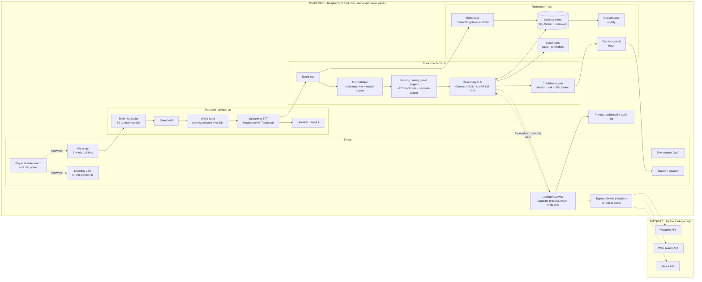

# Kin — Edge Architecture (ADR v0.1)

**A private companion that thinks on a 4 GB Raspberry Pi**

End-to-end architecture for an always-listening personal AI whose reasoning never leaves the device. Primary use case is memory and recall, with productivity (reminders, tasks) as the second domain. Demo path: laptop first, then Raspberry Pi 5 with 4 GB RAM and a 64 GB SD card.

- Owner: Principal Architect
- Status: Proposed
- Date: 1 Oct 2026

---

## 1. System diagram

Everything inside the on-device boundary runs locally. The only thing that crosses it is a structured, schema-checked lookup request from the Lookup Gateway. The reasoning process itself has no network access.


> Keep `kin-system-diagram.png` (or `.svg`) in the same folder as this file so the image shows. The Mermaid version below renders on its own in GitHub, GitLab, Notion, Obsidian and VS Code.



Legend: solid = local data flow · dotted = online lookup path or hardware privacy control.

---

## 2. How a request flows

Two pipelines share the same audio front end. The **passive** pipeline builds memory without being asked. The **active** pipeline answers when you say the wake word or press the button.

### Passive capture (memory)

1. Mic audio lands in a 30-second ring buffer held in RAM. It is overwritten continuously and never written to disk.
2. Silero VAD runs on every 30 ms frame. Silence stops the pipeline there, which keeps CPU and power low.
3. On speech, Moonshine Tiny streams a transcript. Buffer frames are zeroed once transcribed.
4. Every final line that is not filler is stored, encrypted, as an **utterance** (the raw evidence, purged after 14 days) with its EmbeddingGemma vector, and grouped into **episodes** (a new one after 90 s of silence or 10 minutes). The semantic router only marks episodes that are all chatter.
5. When an episode ends and no question is running, Gemma 4 E2B extracts **facts** from it: self-contained sentences with absolute dates, a subject, the people named, and the lines they rest on. A fact close to an existing one is ADDed, UPDATEs or CONTRADICTS it (the old one is superseded, never deleted), or is a DUPLICATE.

Memory v2 in one paragraph: two tiers (utterances as evidence, facts for answers), every change logged in `fact_history`, hybrid recall (vectors + BM25 fused with RRF, time and people from the words, a small reranker, a calibrated abstention threshold), corrections by voice or in the UI, a daily review card, retention and consent settings, encrypted backups, and nightly maintenance. The whole design is in [how-kin-remembers.md](how-kin-remembers.md).

### Active query

1. Wake word or button. The LED switches from steady to pulsing so the user can see the device is attending.
2. Moonshine Small transcribes the query (higher accuracy than Tiny, about half a second on a Pi 5).
3. Routing has three layers:
   - **Safety guard** (anchored regexes, `brain/commands.py`): only "forget the last N minutes", "forget that", "forget everything about <person>" and "cancel the reminder …". Negated or habitual phrasing ("don't forget…", "I always forget…") is never a command. Destructive actions never run at once: Kin says "That's N memories from the last X minutes. Say confirm to delete." and waits 10 s for "confirm" (or the UI's Confirm button).
   - **Hybrid recall first, in parallel with taking the session.** If the best match is strong and the words ask about the user's life, the facts go into the first message and one call answers (no tool-choice call).
   - **Otherwise one Gemma 4 E2B call with tools** (`brain/tools_schema.py`): `recall`, `remember`, `add_task`, `list_tasks`, `complete_task`, `cancel_reminder`, `correct_fact`, `retract_fact`, `review_memory`, `lookup`. The model answers directly (chit-chat, one call) or calls a tool; calls are schema-validated, an invalid one gets one correction and then falls back to recall. At most two tool calls per query. There is no separate routing call.
   - **Semantic tagger** for overheard speech (passive capture, step 4 above).
4. `recall` re-runs hybrid recall with the model's rewording fused in and feeds the facts back with their ids, subject, times and status, best first; the model writes the answer (second call), up to three cited sentences, giving both versions when two active facts disagree. Task tools answer with a fixed sentence (one call).
5. `lookup(kind, query, when)` goes to the gateway only, with names scrubbed and the query capped (80 characters, 12 words); the result comes back as data together with the relevant memories, and the LLM reasons over it locally. If the lookup fails (offline, gateway down), Kin says so and quotes the most relevant memory word for word, with its id; the model gets no second pass, so it cannot invent a forecast or a decision.
6. The confidence gate checks the calibrated confidence and every sentence before Piper speaks: it must cite offered facts, not attribute one person's fact to another, and contain no number the cited facts lack. A direct answer is blocked (and recall runs instead) when memory clearly holds something relevant, so the model cannot skip recall and invent a personal fact.
7. Every LLM use goes through one priority queue: questions first; background tagging and session warm-up after.

---

## 3. Model selection (as of October 2026)

Picked for the 4 GB Pi first, then checked that the same choice runs well on a laptop. Figures are published Raspberry Pi 5 benchmarks; re-measure on your board.

| Role | Primary pick | Why | Pi 5 figures | Alternates |
|---|---|---|---|---|
| **Reasoning LLM** | Gemma 4 E2B (instruction-tuned), LiteRT-LM QAT int4 | Released April 2026, Apache 2.0, built for phones and Pi, native function calling and JSON output | ~7.7–9 tok/s decode · ~96–99 tok/s prefill · ~1.43 GB peak RAM | Qwen3.5-2B (March 2026) via llama.cpp · LFM2.5-1.2B (~850 MB at Q5) as low-RAM fallback |
| **Runtime** | LiteRT-LM | On a 4 GB Pi, Gemma 4 E2B ran under LiteRT-LM while Ollama ran out of memory | 1,432 MB vs 4,406 MB (LiteRT vs llama.cpp) | llama.cpp on the laptop |
| **Routing** | Regex safety guard + Gemma 4 E2B native function calling + EmbeddingGemma k-NN tagger | No extra model: the active query is routed inside the one E2B call, passive lines by the already-loaded embedder | tagger: one embedding per line (the same vector is stored) | Gemma 3 270M was evaluated and removed: stock 7/24 on the keep/drop set |
| **Speech-to-text** | Moonshine v2 Streaming: Tiny (always-on) + Small (queries) | Built for live speech, streams while you talk | Tiny 34M: 12.0% WER, 237 ms · Small 123M: 7.8% WER, 527 ms | Medium 245M (6.65% WER, 802 ms) on laptop |
| **VAD** | Silero VAD (ONNX) | Cheapest way to save power | negligible | WebRTC VAD |
| **Wake word** | openWakeWord, custom "Hey Kin" | Trainable on synthetic speech, CPU-only | negligible | Push-to-talk only |
| **Embeddings** | EmbeddingGemma 300M | Top of its size class on multilingual MTEB; truncate 768-d to 256-d | ~300 MB RAM | bge-small / all-MiniLM |
| **Vector store** | sqlite-vec inside SQLCipher | One encrypted file, no server | sub-ms search | LanceDB |
| **Text-to-speech** | Piper, medium voice | Built for CPU-only boards; real time on Pi 5 | RTF ~0.2 | Inflect-Nano-v2 (RTF 0.11, ~220 ms first audio) · Kokoro-82M on laptop |

Laptop tier: step up to Gemma 4 E4B or Qwen3.5-4B. Keep the same interfaces so the Pi build is a config change.

---

## 4. RAM budget on the 4 GB Pi (estimates)

| Component | Est. RAM |
|---|---|
| Raspberry Pi OS Lite 64-bit, no desktop | ~450 MB |
| Gemma 4 E2B on LiteRT-LM (mmap'd per-layer embeddings) | ~1,450 MB |
| Moonshine Tiny + Small streaming | ~250 MB |
| EmbeddingGemma 300M | ~300 MB |
| Router (semantic tagger: ~100 example vectors) | < 1 MB |
| Piper medium voice, VAD, wake word | ~200 MB |
| Python app, SQLite, gateway, dashboard | ~300 MB |
| **Total / headroom** | **~3.0 GB / ~1.0 GB** |

- Enable zram as a safety net. Do not swap to the SD card.
- Hard cap LLM context at 2K tokens so the KV cache cannot balloon.
- Models take about 3 GB of the 64 GB card. Use an A2-rated card, or move to an NVMe HAT when possible.

---

## 5. The online/offline boundary

Enforced in layers rather than by convention:

- **Process isolation.** The reasoning process runs under systemd with `PrivateNetwork=yes`, so it has no network interface. It talks to the gateway only over a local Unix socket.
- **Narrow interface.** The gateway accepts only `{"kind":"weather|search|news","params":{…}}`. Params are schema-checked, length-capped and scrubbed of names from the memory store. No transcript, prompt or memory text can pass.
- **Firewall allowlist.** nftables drops all outbound traffic except from the gateway's user to three hostnames. A packet capture during the demo proves it.
- **Visible to the user.** The LED flashes blue during a lookup, the spoken answer says "I checked the weather online", and the dashboard lists every call with its exact payload.

> **Demo script.** "Hey Kin, do I need an umbrella for the coffee with Priya I mentioned this morning?" Meeting time and place come from local memory. The forecast comes from the weather API. The decision is made by Gemma on the Pi. Then turn Wi-Fi off and ask a recall question to show reasoning still works.

---

## 6. Privacy and hardware controls

- **Mute switch in hardware.** A slide switch breaks the microphone's power line. Software cannot override it. A GPIO line reads the switch so the app can say "I'm muted".
- **LED tied to the same rail.** The listening light is powered from the mic supply, so it cannot show "off" while the mic is live. A second, software-driven colour shows state: steady green listening, pulsing white attending, blue online lookup, amber thinking.
- **Raw audio never stored.** Audio exists only in the RAM ring buffer. Transcripts and memories are encrypted at rest with SQLCipher.
- **Bystander handling.** Optional speaker ID keeps only the owner's utterances in long-term memory by default.
- **Forget command.** "Forget the last ten minutes" deletes rows and vectors immediately.

---

## 7. Honest fallback behaviour

- **Retrieval floor.** Below a similarity threshold, Kin says it does not remember and shows the closest match.
- **Grounded prompts.** Recall answers must cite the memory ID they came from; uncited answers are blocked.
- **Capability map.** Out-of-scope requests (long maths, legal or medical judgement, long documents) get a fixed, honest reply.
- **Never escalate reasoning to the cloud.** The device may offer a factual lookup; the cloud never does the thinking.
- **Timeouts.** If generation runs past 20 s, it stops and gives a short version.

---

## 8. Latency budget (Pi 5, recall query)

| Stage | Target |
|---|---|
| Wake word detected | < 200 ms |
| STT final (Moonshine Small) | ~0.5 s |
| Embed query + vector search (in parallel with the routing call) | ~0.4 s |
| Routing call: prefill the question only (system prompt + tools pre-warmed) + decode the tool call | ~3–4 s |
| Answer call: prefill the tool result (~400 tokens) | ~4 s |
| First spoken words (stream 1st sentence to Piper) | ~1.5 s after first tokens |
| **Time to first audio** | **~8–9 s** |

Prefill is the bottleneck. The system prompt + tool definitions (~950 tokens) are byte-identical on every query; LiteRT-LM 0.17 has no prefix-cache or session-clone API, so Kin prefills them into a spare session while idle and hands it to the next question (a session is never reused across questions, so forgotten memories cannot linger in a KV cache). LiteRT-LM cannot interrupt a prefill, so a question that arrives during a warm-up waits for its remainder. Keep retrieved memories short, and play a short acknowledgement ("Let me check") while the model works.

Measured on the development laptop (median of 3, warm session ready): recall 4.8 s to first audio (was 3.4 s with keyword routing and one call), umbrella lookup 2.8 s to first audio and 6.8 s total (was 5.7 s / 11.6 s). Back-to-back questions, which wait for the warm-up: recall ~11 s, lookup ~9 s.

---

## 9. Software layout

```text
kin/
  audio/      capture.py  ring_buffer.py  vad.py  wake.py  stt.py
  brain/      orchestrator.py  commands.py (safety guard)  tools_schema.py  semantic_router.py  llm_queue.py  llm.py  prompts/  gate.py
  memory/     embed.py  store.py (SQLCipher+sqlite-vec+FTS5)  query.py  retrieval.py  rerank.py  service.py  backup.py
  tools/      tasks.py  reminders.py  lookup_client.py
  gateway/    server.py  schemas.py  providers/{weather,search,news}.py
  io/         tts.py  led.py  switch.py (GPIO)
  ui/         dashboard (FastAPI, localhost only)
  config/     laptop.yaml  pi5.yaml
deploy/       kin-brain.service (PrivateNetwork=yes)  kin-gateway.service  nftables.conf
```

---

## 10. Hardware bill of materials

| Part | Note |
|---|---|
| Raspberry Pi 5, 4 GB | Official active cooler is mandatory |
| 64 GB A2 microSD | NVMe HAT + small SSD is the first upgrade |
| USB or I²S mic array (2–4 mics) | Beamforming helps far-field capture |
| Slide switch + RGB LED | Switch in series with mic power; LED on the same rail |
| Small I²S amp + 3 W speaker | For Piper output |
| 27 W USB-C PSU, or 5 V 5 A power bank | Peak draw under LLM load is in the low teens of watts |

---

## 11. Power design

- Duty-cycle everything behind the VAD; in a quiet room only VAD and wake word run.
- Keep LLM weights memory-mapped but idle.
- Run memory maintenance once a night or as soon as on mains power (retention purges, FTS optimize, VACUUM, integrity check).
- Cap CPU frequency on battery and accept slower answers.

---

## 12. Risks and mitigations

| Risk | Mitigation |
|---|---|
| **High** — Out-of-memory on 4 GB | LiteRT-LM not Ollama, zram, lazy-load Small STT and embedder, hard context cap |
| **High** — Slow first answer | KV-cached system prompt, short retrieval, spoken acknowledgement, streamed TTS |
| **Med** — Thermal throttling | Active cooler, airflow, monitor `vcgencmd measure_temp` |
| **Med** — Hallucinated recall | Citation-required answers and a similarity floor |
| **Low** — Lookup leaks context | Enum-only gateway, name scrubbing, firewall allowlist, audit log |

---

## 13. Build order

1. Laptop: VAD → Moonshine → transcript log. Prove passive capture.
2. Laptop: memory store + EmbeddingGemma + Gemma 4 E2B recall answers with citations.
3. Laptop: Lookup Gateway with weather only, in its own process. Record the demo.
4. Pi 5: same code with `pi5.yaml`. Measure RAM and latency; tune context and loading.
5. Pi 5: wire switch and LED, firewall rules, systemd units, dashboard.
6. Add tasks and reminders, and the honest-fallback messages.

---

## Sources

- [Raspberry Pi: edge AI with LiteRT and Gemma](https://www.raspberrypi.com/news/mastering-edge-ai-on-raspberry-pi-with-litert-and-gemma/)
- [Gemma 4 E2B on a 4 GB Pi 5 (LiteRT vs Ollama)](https://raspberry.tips/en/kuenstliche-intelligenz/gemma-raspberry-pi-5-litert)
- [Google LiteRT-LM: Gemma 4 models](https://developers.google.com/edge/litert-lm/models/gemma-4)
- [Small language models ranked, 2026](https://localaimaster.com/blog/small-language-models-guide-2026)
- [Qwen3.5 Small model family](https://www.therundown.ai/tools/qwen3-5-small)
- [Running LLMs on Raspberry Pi 5 (LFM2.5 figures)](https://tinyweights.dev/posts/run-llms-raspberry-pi-5/)
- [Moonshine v2 vs Whisper benchmarks](https://modelslab.com/blog/audio-generation/moonshine-vs-whisper-asr-real-time-speech-2026)
- [Local TTS comparison (Piper)](https://www.promptquorum.com/power-local-llm/local-tts-voice-cloning-piper-coqui-xtts)
- [Inflect-Nano-v2 Pi 5 measurements](https://huggingface.co/litert-community/Inflect-Nano-v2)
- [EmbeddingGemma overview](https://www.starkinsider.com/2025/09/google-embeddinggemma-on-device-rag-search.html)

RAM and latency figures marked as estimates should be replaced with measurements from step 4 of the build order.
